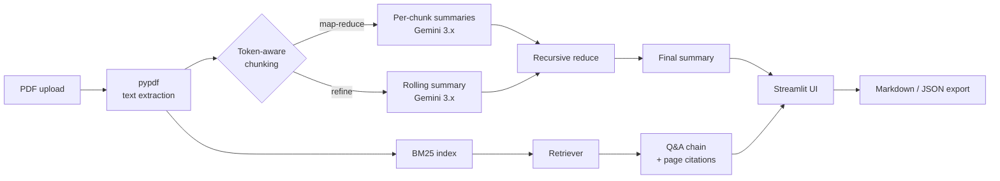

# 📄 PDF Summarizer AI

**Turn long PDFs into clear summaries — then ask them questions.**

A production-style document assistant built with **LangChain**, **Google Gemini** and **Streamlit**.
Upload a research paper, report, contract or lecture notes; get a structured summary in seconds,
then chat with the document and get answers with page-level citations.

[](https://www.python.org/)
[](https://python.langchain.com/)
[](https://ai.google.dev/)
[](https://streamlit.io/)
[](LICENSE)

---

## ✨ Features

| | |
|---|---|
| 📚 **Any text PDF** | Multi-file upload, up to 50 MB / 500 pages per document |
| 🧠 **Two summarisation strategies** | **Map-reduce** for speed, **Refine** for maximum coherence on long documents |
| 🎯 **Five summary styles** | Executive brief, key points, TL;DR, narrative, study notes |
| 📏 **Three lengths** | Brief, standard, in-depth |
| 🌍 **Eight output languages** | Summarise in a different language than the source |
| 💬 **Chat with the document** | BM25 retrieval + grounded answers with `(p. 4)` citations |
| 📑 **Page explorer** | Read the extracted text per page and summarise a single page on demand |
| ⬇️ **Exports** | Download the summary as Markdown or JSON, and the raw text as `.txt` |
| ⚡ **Smart caching** | Results are keyed by file hash + settings; switching tabs never re-bills you |
| 🛡️ **Guard rails** | Scanned-PDF detection, retries with backoff, quota handling, automatic model fallback |
| ✅ **Tested** | 32 unit tests, no API key required (fake LLM) |

---

## 🏗️ Architecture



**Why two strategies?** A 200-page report does not fit in one context window. Map-reduce summarises
chunks independently (fast, parallel-friendly), while refine carries a single running summary through
the document (slower, but produces smoother prose). The reducer groups intermediate summaries
recursively when the combined text still exceeds the model budget.

---

## 🚀 Quickstart

### 1. Clone and enter the project

```bash
git clone https://github.com/vivek93sahu-eng/pdf-summarizer-gemini.git
cd pdf-summarizer-gemini
```

### 2. Create a virtual environment

```bash
python -m venv .venv
# Windows
.venv\Scripts\activate
# macOS / Linux
source .venv/bin/activate
```

### 3. Install dependencies

```bash
pip install -r requirements.txt
```

### 4. Add your Gemini API key

Get a free key at **[aistudio.google.com/apikey](https://aistudio.google.com/apikey)**, then:

```bash
copy .env.example .env      # Windows
cp .env.example .env        # macOS / Linux
```

```ini
GEMINI_API_KEY=your_key_here
GEMINI_MODEL=gemini-3.1-flash-lite
```

### 5. Verify everything

```bash
python scripts/smoke_test.py
```

### 6. Run the app

```bash
streamlit run app.py
```

Open <http://localhost:8501>, drop a PDF, and press **Summarise**.

> A one-page sample lives in [`samples/`](samples). Run `python scripts/fetch_samples.py` to also
> download a 15-page paper used by the smoke test and the walkthrough below.

---

## ⚙️ Configuration

All settings are optional except the API key.

| Variable | Default | Purpose |
|---|---|---|
| `GEMINI_API_KEY` | — | **Required.** Google AI Studio key (`GOOGLE_API_KEY` also accepted) |
| `GEMINI_MODEL` | `gemini-3.1-flash-lite` | Default model; overridable in the sidebar |
| `GEMINI_TEMPERATURE` | `0.2` | 0 = literal, 1 = creative |
| `GEMINI_MAX_OUTPUT_TOKENS` | `4096` | Upper bound per model call |
| `CHUNK_TOKENS` | `6000` | Chunk size; smaller = more precise, more calls |
| `CHUNK_OVERLAP_TOKENS` | `400` | Context carried between chunks |
| `MAX_FILE_MB` | `50` | Upload guard rail |
| `MAX_PAGES` | `500` | Page guard rail |
| `REQUEST_TIMEOUT` | `180` | Seconds per Gemini call |
| `MAX_RETRIES` | `3` | Attempts per call on 429/5xx |

Models available in the sidebar are defined in [`src/config.py`](src/config.py) — Google retires
preview models regularly, so update that dictionary if one disappears.

---

## 🧩 Project structure

```
pdf-summarizer-gemini/
├── app.py                   # Streamlit UI (upload, settings, summary, chat, exports)
├── src/
│   ├── config.py            # env settings, model list, styles, lengths, guard rails
│   ├── pdf_loader.py        # PDF parsing, page text, scanned-PDF detection
│   ├── summarizer.py        # chunking + map-reduce / refine chains, retries, fallbacks
│   ├── qa.py                # BM25 retrieval + grounded Q&A with citations
│   ├── prompts.py           # every prompt in one auditable place
│   └── utils.py             # token counting, hashing, formatting, content-block parsing
├── scripts/smoke_test.py    # end-to-end connectivity check
├── tests/                   # 32 offline unit tests (fake LLM)
├── samples/                 # demo PDFs
├── .streamlit/config.toml   # theme + upload limits
├── Dockerfile
└── requirements.txt
```

---

## 🧪 Testing

```bash
pip install -r requirements-dev.txt
pytest -q
```

The suite uses LangChain's `FakeListChatModel`, so **no API key or network access is needed**.
It covers chunk boundaries, both summarisation strategies, progress callbacks, retry/error
classification, BM25 retrieval order, citation generation and the text-cleaning helpers.

---

## ☁️ Deployment

### Streamlit Community Cloud

1. Push the repository to GitHub.
2. On <https://share.streamlit.io>, pick the repo, branch `main`, main file `app.py`.
3. In **Settings → Secrets**, add:
   ```toml
   GEMINI_API_KEY = "your_key_here"
   ```
   The app mirrors `st.secrets` into the environment at startup, so no code changes are needed.
4. Deploy. The `.env` file is git-ignored and is never required in the cloud.

### Docker

```bash
docker build -t pdf-summarizer .
docker run -p 8501:8501 --env-file .env pdf-summarizer
```

---

## 🛠️ Troubleshooting

| Symptom | Fix |
|---|---|
| `GEMINI_API_KEY is not set` | Create `.env` next to `app.py`, restart Streamlit |
| `The selected model is no longer available` | Pick another model in the sidebar; Google retires models often |
| `Gemini rate limit or quota reached` | Wait a minute, or switch to a lighter model (Flash Lite) |
| `No text could be extracted` | The PDF is scanned — run OCR (e.g. `ocrmypdf`) first |
| Summary misses detail on a huge PDF | Use **Refine** instead of map-reduce and a smaller chunk size |
| First run is slow | `tiktoken` downloads its tokenizer once and caches it |

---

## 🗺️ Roadmap

- [ ] Embedding-based retrieval (Chroma/FAISS) instead of BM25
- [ ] Multi-document comparison mode
- [ ] OCR fallback for scanned PDFs
- [ ] Streaming token-by-token summaries
- [ ] Cost estimate per summary

---

## 📜 License

Released under the [MIT License](LICENSE).

## 🙏 Acknowledgements

Inspired by the many PDF-summariser experiments in the LangChain + Gemini ecosystem, and built on
[LangChain](https://python.langchain.com/), [Google Gemini](https://ai.google.dev/),
[Streamlit](https://streamlit.io/) and [pypdf](https://pypdf.readthedocs.io/).
